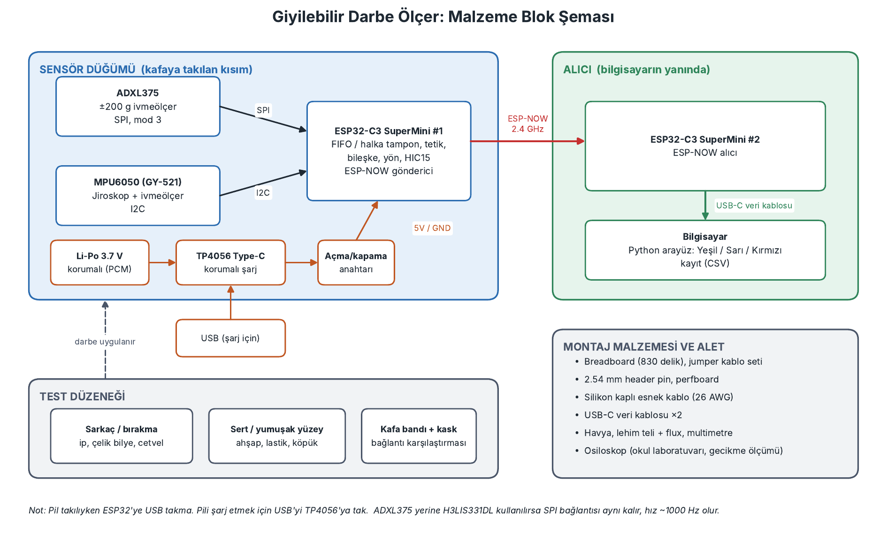

# Dual-Sensor High-G Impact Meter and Threshold-Based Early Warning System for Combat Sports

Dövüş sporlarında kafa darbelerini anlık ölçen, giyilebilir darbe ölçer ve eşik tabanlı erken uyarı (triyaj) sistemi. Bitirme projesi, KKÜ Elektrik-Elektronik Mühendisliği.

> Bu sistem tıbbi tanı koymaz. Ölçülen darbeyi sınıflandırıp uyarı üretir; sarsıntı (concussion) tanısı hekim değerlendirmesi gerektirir.

---

## 1. Proje ve benim alt sistemim

**Proje:** Sporcunun başına (kafa bandı veya kask) takılan bir sensör düğümü darbe anındaki ivmeyi ve açısal hızı ölçer. Darbe bir eşiği aşınca olayı özetleyen bir paketi kablosuz olarak bilgisayardaki alıcıya gönderir. Bilgisayar darbeyi Yeşil / Sarı / Kırmızı olarak gösterir ve kaydeder.

**Benim alt sistemim: donanım ve gömülü sistem**

- Sensör düğümünün donanımı: ADXL375 (±200 g, SPI), MPU6050 (6 eksen, I2C), ESP32-C3 SuperMini, Li-Po pil, TP4056 şarj ve koruma modülü, açma/kapama anahtarı.
- Gömülü yazılım:
  - ADXL375'i SPI ile hedef 3200 Hz'de okumak (gerçekleşen hız: 3187–3194 örnek/s, FIFO taşması 0; bkz. Hafta 5)
  - Halka tamponda darbe öncesi ve sonrası veriyi tutmak
  - Eşik aşımında olayı tetiklemek (eşik: ___ g, önerideki başlangıç değeri 10 g, doğrulanmalı)
  - Tepe ivme, darbe süresi, Δv ve HIC15'i hesaplamak
  - Doyan (saturated) olayları işaretlemek
  - Olay paketini kablosuz göndermek
- Alıcı ESP32-C3: paketleri alıp USB üzerinden bilgisayara CSV satırı olarak aktarmak.

Bilgisayar tarafındaki arayüz (Python) bu alt sistemin dışındadır: ___

---

## 2. Blok şema



PDF hâli: [Malzeme_Blok_Semasi.pdf](Malzeme_Blok_Semasi.pdf)

**İvmeölçerler**
- **ADXL375:** Asıl darbe sensörü. ±200 g ölçüm aralığı, SPI mod 3. Yüksek g'lik tepe değerini doymadan ölçmek için seçildi.
- **MPU6050 (GY-521):** Dönme (jiroskop, ±2000 °/s) verisi ve ikincil ivme (±16 g). Sert darbede ivme kanalı doyar, bu yüzden tepe ivme için kullanılmaz.

**ESP32-C3 SuperMini (×2)**
- **#1 sensör düğümü:** Sensörleri okur, olayı tetikler, özetleri hesaplar, paketi gönderir.
- **#2 alıcı:** USB-C ile bilgisayara bağlıdır, başka bağlantısı yoktur.

**Pin planı (sensör düğümü)**

| Sensör pini | ESP32-C3 pini | Not |
|---|---|---|
| ADXL375 SCL (SCK) | GPIO4 | SPI saat |
| ADXL375 SDO (MISO) | GPIO5 | |
| ADXL375 SDA (MOSI) | GPIO6 | |
| ADXL375 CS | GPIO7 | |
| ADXL375 INT | GPIO3 | Tetik / veri hazır |
| MPU6050 SDA | GPIO8 | I2C |
| MPU6050 SCL | GPIO9 | I2C |
| MPU6050 AD0 | GND | Adres 0x68 |
| ADXL375 VIN, MPU6050 VCC | 3V3 | |

**Kablosuz bağlantı:** Sensör düğümünden alıcıya ESP-NOW (2.4 GHz). Gerekçesi 5. bölümde.

**Pil ve şarj hattı**
- Li-Po 3.7 V 450 mAh (korumalı) → TP4056 B+/B−
- TP4056 OUT+ → kaydırmalı anahtar → ESP32-C3 5V; OUT− → GND
- Şarj: USB-C kablo TP4056'nın kendi soketine takılır.
- TP4056'nın PROG direnci 1.2 kΩ'dan 4.7 kΩ'a değiştirilecek. Hedef şarj akımı yaklaşık 255 mA (ölçülen: ___ mA).
- Pil bağlıyken ve anahtar açıkken ESP32-C3'e USB takılmaz.

---

## 3. Malzeme durum tablosu

| Parça | Blok şemadaki görevi | Durum | Eksikse yapılacak iş | Yedek seçenek (ölçüm aralığı, arayüz) |
|---|---|---|---|---|
| Adafruit ADXL375 (5374) | Asıl darbe sensörü, yüksek g ivme ölçümü | ✅ Elimde | Header lehimle, 02_adxl375_olcum ile SPI testi yap (DEVID 0xE5, durağanken Z ≈ 20 LSB), sonra 09_adxl375_int_test ile INT (GPIO3) testi | H3LIS331DL: ±100/200/400 g, SPI/I2C. Yazılım geliştirme için ADXL345: ±16 g, SPI/I2C |
| ESP32-C3 SuperMini (×2) | #1 sensör düğümü; #2 alıcı (USB ile bilgisayara) | ✅ Elimde | — | ESP32-S3 geliştirme kartı: ESP-NOW, SPI/I2C |
| GY-521 MPU6050 | Dönme (jiroskop) verisi + ikincil ivme | ✅ Elimde | — | LSM6DSO32: ivme ±32 g, jiroskop ±2000 °/s, SPI/I2C |
| USB-C veri kablosu | Programlama, seri port, alıcı-bilgisayar bağlantısı | ✅ Elimde | — | Veri hatlı başka bir USB-C kablo |
| Breadboard, 830 delik | Lehimsiz ilk kurulum | ✅ Elimde | — | 400 delikli breadboard |
| Jumper kablo seti | Breadboard bağlantıları | ✅ Elimde | — | ___ |
| 2.54 mm erkek header pin | Kartları breadboard'a takmak için | ✅ Elimde | — | 2.54 mm dişi header (soket) |
| Perfboard, 5×7 cm | Kalıcı prototip | ✅ Elimde | — | Farklı boyutta 2.54 mm delikli plaket |
| Silikon kaplı kablo, 26 AWG | Kalıcı, esnek bağlantılar | ✅ Elimde | — | 24-28 AWG çok damarlı kablo |
| Sertec Li-Po 3.7 V 450 mAh, korumalı | Sensör düğümünün güç kaynağı | ✅ Elimde | — | 3.7 V 1S Li-Po, korumalı, 500 mAh civarı |
| TP4056 Type-C korumalı modül | Pil şarjı + aşırı deşarj/kısa devre koruması | ✅ Elimde | — | 1S Li-Po şarj modülü, şarj akımı ayarlanabilir (___) |
| IC-205 kaydırmalı anahtar | Açma/kapama (OUT+ → ESP32 5V) | ✅ Elimde | — | SPDT kaydırmalı anahtar, akım değeri ___ |
| 4.7 kΩ SMD direnç (0805/0603) | TP4056 şarj akımını ~255 mA'e indirmek | ✅ Elimde | — | 4.7 kΩ 1/4 W bacaklı direnç |

Excel hâli: [Malzeme_Durum_Tablosu.xlsx](Malzeme_Durum_Tablosu.xlsx)

---

## 4. Ortam kurulumu ve ilk seri çıktı

| Ayar | Değer |
|---|---|
| Ortam | Arduino IDE 2.3.10 |
| Kart paketi | esp32 by Espressif Systems 3.3.12 |
| Sürücü | Ek sürücü kurulmadı |
| Kart seçimi | ESP32C3 Dev Module |
| USB CDC On Boot | Enabled |
| Port | Kart 1 → COM7, Kart 2 → COM8 |
| Seri port hızı | 115200 baud |

Test kodu: [01_sayac.ino](firmware/01_sayac/01_sayac.ino)

```cpp
uint32_t n = 0;

void setup() {
  Serial.begin(115200);
}

void loop() {
  Serial.println(n++);
  delay(1000);
}
```

**İlk seri çıktı**

Kart 1 (COM7):
```
17:55:21.145 -> 60
17:55:22.145 -> 61
17:55:23.150 -> 62
17:55:24.183 -> 63
17:55:25.177 -> 64
```

Kart 2 (COM8):
```
17:59:25.506 -> 6
17:59:26.481 -> 7
17:59:27.530 -> 8
17:59:28.529 -> 9
17:59:29.538 -> 10
```

Ayrıntılı not: [Hafta 1: Çalışma ortamı kurulumu](docs/hafta1_ortam_kurulumu.md)

---

## 5. Kablosuz paket sözleşmesi (taslak)

### Kablosuz yöntem seçimi

Sensör düğümü ile alıcı arasında **ESP-NOW** kullanılıyor. ESP-NOW, iki ESP32 arasında erişim noktası (modem) ve bağlantı kurma aşaması olmadan doğrudan çerçeve gönderir. Darbe olayında ilk paketin, bağlantı kurulumunu beklemeden çıkmasını sağlar. Bir paket 250 bayta kadar veri taşıyabildiği için olay özetinin tamamı (aşağıdaki 29 bayt) tek pakete sığar. Alıcı da bir ESP32-C3 olduğu için telefon uygulaması gerekmez, veri USB üzerinden doğrudan bilgisayara aktarılır. BLE alternatifinde bağlantı aralığı (en az 7.5 ms, iOS'ta en az 15 ms) ve varsayılan 20 baytlık bildirim yükü, paketin bölünmesini ve uygulama tarafında ek iş gerektirirdi. Wi-Fi ise bir erişim noktasına bağlı olmayı gerektirir. ESP-NOW'un dezavantajı ayrı bir alıcı kart gerektirmesi ve teslimatı garanti etmemesidir. Kayıp paketler sıra numarasıyla tespit edilir. Hedef uçtan uca gecikme: ___ (kaynağı olan bir değer bulunamadı; bkz. Hedef Değerler) (Hafta 4'te ölçülen: Tek yön tahmini ortalama 1.53 ms, en çok 4.48 ms (RTT/2, kartlar yakın) ms). Yakın mesafede kayıp %0 (1000/1000). Menzil testi: ___

### Ön sonuç: gerçek sensör verisiyle gecikme ve kayıp (Hafta 5)

Breadboard'daki sensör düğümü ADXL375'i 3200 Hz, MPU6050'yi 1 kHz okurken 29 baytlık 0x01 paketini gerçek sensör verisiyle 100 ms aralıkla 1000 kez gönderdi. Ortam etkisini ayırmak için aynı yerde, aynı mesafede sensörsüz Hafta 4 kodu da yeniden çalıştırıldı (kontrol). Gecikme, vericinin kendi saatiyle gidiş-dönüş süresidir (RTT); tek yön RTT/2 ile tahmin edilir.

| Ölçüm | Hafta 4: sensörsüz, ilk ortam | Kontrol: sensörsüz, aynı ortam | Gerçek sensör verisiyle |
|---|---|---|---|
| Kod | 06 / 07 | 06 / 07 | 04 / 05 |
| Kartlar arası mesafe | yan yana | ~20 cm | ~20 cm |
| Ortam | ___ | kalabalık kafe: 3–4 Wi-Fi ağı, çok sayıda elektronik cihaz, kahve makineleri | aynı kafe, aynı oturum |
| Gönderilen / yankı alınan | 1000 / 1000 | 1000 / 996 | 1000 / 976 |
| Gidiş-dönüş kaybı | %0 | %0.4 | %2.4 |
| RTT min / ort / maks | 2.79 / 3.06 / 8.96 ms | 2.33 / 3.49 / 21.00 ms | 2.62 / 4.62 / 40.17 ms |
| RTT p50 / p95 / p99 (250 µs kutu) | ≤3.00 / ≤4.25 / ≤5.75 ms | ≤2.75 / ≤6.75 / ≤12.25 ms | ≤3.00 / ≤12.50 / ≤28.50 ms |
| RTT'si 10 ms'yi aşan paket | 0 | 14 | 61 |
| Tek yön tahmini (RTT/2) min / ort / maks | 1.40 / 1.53 / 4.48 ms | 1.17 / 1.74 / 10.50 ms | 1.31 / 2.31 / 20.09 ms |
| Test sırasında ADXL375 örnek/s, FIFO taşması | — | — | 3187.8–3191.2, 0 |
| Test sırasında MPU6050 örnek/s | — | — | 991.8–994.8 |
| Durağanken 100 ms'lik penceredeki tepe bileşke ivme | — | — | 2.06–4.36 g |

Darbe denemesi (ADXL375 kartına kalemle vurma): 9 vuruşta 10 olay paketi gönderildi, 10'unun yankısı alındı. Bir vuruş iki olay üretmiş; hangisi olduğu logdan ayrılamıyor. Tepe bileşke ivme 10.19–23.77 g. Tetikten yankıya süre 102.7–104.4 ms; bunun yaklaşık 100 ms'si tetikten sonraki 320 örneklik özet penceresidir.

Gözlemler:
- Sensörsüz kontrol de Hafta 4'ten kötü çıktı; ölçüm ortamı sonucu etkiliyor. Bu testler kalabalık bir kafede, birden fazla Wi-Fi ağının olduğu 2.4 GHz ortamında yapıldı. Dövüş sporu salonunda da seyirci telefonları ve Wi-Fi ağları olacağı için bu, sessiz bir odadan daha zorlu bir koşul.
- Aynı ortamda sensör okuması açıkken ortanca RTT değişmedi (≤3.00 ve ≤2.75 ms), uzun gecikmeler arttı (10 ms'yi aşan paket 61 ve 14).
- Sensörlü testteki 24 kaybın 20'si sıra 122–169 arasında, yaklaşık 5 s'lik bir patlamada. Kalan pakette 4 kayıp var, kontrolle aynı düzeyde. Patlamanın nedeni tek koşuyla ayrılamadı.
- Alıcının logunun olduğu aralıkta kaybolan paketlerin hiçbiri alıcıya ulaşmamış; kayıp vericiden alıcıya giden yolda.
- Her koşu bir kez yapıldı. Ham loglar: [docs/veri/hafta5](docs/veri/hafta5). Ayrıntı: [Hafta 5 notu](docs/hafta5_sensor_dogrulama.md).

### Genel kurallar
- Bayt sırası: little-endian. Yapı `__attribute__((packed))`, dolgu baytı yok.
- Tüm ölçekler tasarım tercihidir, ölçüm sonucu değildir.
- `zaman_damgasi_us` vericinin açılıştan beri saydığı mikrosaniyedir. 2³² µs ≈ 71.6 dakikada sıfıra döner.

### Paket tipi 0x01: Darbe olayı

| Alan adı | Bayt | Veri tipi | Birim | Açıklama |
|---|---|---|---|---|
| `protokol_surumu` | 1 | uint8 | — | Sözleşme sürümü. İlk sürüm: 1 |
| `paket_tipi` | 1 | uint8 | — | 0x01 = darbe olayı, 0x02 = durum |
| `cihaz_id` | 1 | uint8 | — | Sensör düğümü numarası |
| `sira_no` | 2 | uint16 | — | Her pakette 1 artar. Kayıp paket tespiti için |
| `zaman_damgasi_us` | 4 | uint32 | µs | Tetik anı (eşiğin ilk aşıldığı örnek) |
| `tepe_ivme_bilesik` | 2 | uint16 | 0.01 g | √(x²+y²+z²) tepe değeri, ADXL375'ten |
| `tepe_ivme_x` | 2 | int16 | 0.01 g | Tepe anındaki X ekseni |
| `tepe_ivme_y` | 2 | int16 | 0.01 g | Tepe anındaki Y ekseni |
| `tepe_ivme_z` | 2 | int16 | 0.01 g | Tepe anındaki Z ekseni |
| `tepe_acisal_hiz` | 2 | uint16 | 0.1 °/s | Bileşke açısal hız tepe değeri, MPU6050'den |
| `darbe_suresi_us` | 2 | uint16 | µs | Bileşke ivmenin eşiğin üstünde kaldığı süre |
| `delta_v` | 2 | uint16 | mm/s | Darbe penceresinde ivmenin integrali |
| `hic15` | 2 | uint16 | — | HIC15 (birimsiz) |
| `seviye` | 1 | uint8 | — | 0 = Yeşil, 1 = Sarı, 2 = Kırmızı. Eşikler: ___ |
| `bayraklar` | 1 | uint8 | bit alanı | bit0 ADXL375 doydu, bit1 MPU6050 doydu, bit2 düşük pil, bit3 tampon taştı, bit4 test paketi (periyodik ölçüm paketi, darbe değil), bit5-7 ayrılmış |
| `pil_mv` | 2 | uint16 | mV | Pil gerilimi |
| **Toplam** | **29** | | | |

ADXL375 doyduysa (`bayraklar` bit0) tepe değer ve HIC15 gerçek değerin altında kalır. Bu olaylar en az Sarı olarak gösterilir.

### Paket tipi 0x02: Durum (periyodik)

| Alan adı | Bayt | Veri tipi | Birim | Açıklama |
|---|---|---|---|---|
| `protokol_surumu` | 1 | uint8 | — | 1 |
| `paket_tipi` | 1 | uint8 | — | 0x02 |
| `cihaz_id` | 1 | uint8 | — | |
| `sira_no` | 2 | uint16 | — | Olay paketleriyle aynı sayaç |
| `zaman_damgasi_us` | 4 | uint32 | µs | Gönderim anı |
| `pil_mv` | 2 | uint16 | mV | |
| `bayraklar` | 1 | uint8 | bit alanı | Olay paketiyle aynı tanım |
| **Toplam** | **12** | | | |

Gönderim aralığı: ___ s

---

## 6. Açık sorular

1. **Tetik eşiği:** Başlangıç değeri 10 g [doğrulanmalı]. Günlük hareketlerde (koşma, zıplama) yanlış alarm sayısı: ___
2. **Seviye eşikleri:** Yeşil / Sarı / Kırmızı sınırları hangi ölçüte (tepe g, HIC15, Δv) ve hangi değerlere göre belirlenecek? ___
3. **Örnekleme hızı:** ADXL375 3200 Hz'de FIFO ile kayıpsız okunabiliyor mu? Ölçülen örnek/s: 3187–3194, FIFO taşması 0 (breadboard, Hafta 5, iki oturum). Bu hızda durağan gürültü std ≈ 15/15/20 LSB (X/Y/Z), 800 Hz'te yarısı; hız ile gürültü arasındaki seçim açık
4. **HIC15 nerede hesaplanacak:** Sensör düğümünde mi, bilgisayarda mı? Düğümde hesaplanırsa işlem süresi: ___ ms
5. **Ham veri:** Yalnız olay özeti yeterli mi, yoksa darbe penceresinin ham dalga formu da (birden fazla pakette) gönderilmeli mi?
6. **Zaman senkronizasyonu:** Vericinin µs saati ile alıcının/bilgisayarın saati nasıl eşleştirilecek? Gecikme ölçümü bu eşleştirmeye bağlı.
7. **ESP-NOW adresleme:** Yayın (broadcast) mı, alıcının MAC adresine doğrudan (unicast) mı? Şifreleme gerekli mi?
8. **Paket bütünlüğü:** ESP-NOW'un MAC katmanı kontrolü yeterli mi, ek CRC alanı eklenmeli mi?
9. **Menzil ve kayıp:** Kafa ve vücut, sinyali ne kadar zayıflatıyor? Ölçülen menzil: ___ m, kayıp oranı: ___
10. **Pil süresi:** ≥2 saat hedefi karşılanıyor mu? Ölçülen süre: ___
11. **Montaj:** Kafa bandı ile kask montajı arasındaki tepe ivme farkı: ___
12. **Δv referansı:** Düşürme testinde çarpma hızı düşme yüksekliğinden hesaplanacak. Hata kaynakları (sürtünme, sekme): ___
13. **ADXL375 kartının doğrulanması:** DEVID ADXL345 ile aynı (0xE5). Durağanken Z ekseninin yaklaşık 20 LSB olması bekleniyor. Ölçülen (Hafta 5, beş açılış): DEVID 0xE5; durgun ortalama Z = 12.66–15.22 LSB, X = 7.08–9.77 LSB, Y = 6.94–9.16 LSB. Z beklenenden düşük, X ve Y sıfırdan farklı; bu fark eksen ofsetlerinden olabilir (veri sayfası: 0 g ofset tipik ±400 mg, en kötü ±6000 mg). Altı yüzlü kalibrasyon: ___

---

## 7. Literatür özeti

İncelenen çalışmalarda giyilebilir ataletsel algılayıcılarla düşme ve darbe tespiti yaygın olmakla birlikte, doğrulama çoğunlukla sınıflandırma başarımı ve gecikme ölçütleriyle yapılmış, algılayıcının ölçtüğü ivmenin bir referansa göre doğruluğu nadiren raporlanmıştır [4], [5]. Kask tabanlı bir IoT sistemi darbe ve düşmeyi algılayıp gerçek zamanlı uyarı göndermekte, ancak ivme ölçümünün doğruluğuna ilişkin bir değerlendirme sunmamaktadır [1]. Tepe kafa ivmesi ve HIC15 gibi kafa yaralanması ölçütleri araç-yaya çarpışması bağlamında çok gövdeli model ve manken deneyleriyle incelenmiş, giyilebilir bir algılayıcıyla ölçülmemiştir [2]. Referans ivmeölçerle algılayıcı düzeyinde metrolojik karakterizasyon yapan çalışma düşük genlik (1–4 m/s²) ve düşük frekans (1–8 Hz) aralığıyla sınırlı kalmış [3], yüksek g darbeler altında doyma ve ölçüm aralığı davranışı ise algılayıcı tasarımı çalışmalarında ele alınmamıştır [6]. Bu proje, ±200 g'lik bir ivmeölçeri kontrollü düşürme deneylerinde düşme yüksekliğinden hesaplanan çarpma hızına göre doğrulayarak ve doyan olayları işaretleyerek, incelenen çalışmalardaki bu boşluğun algılayıcı düzeyindeki kısmına yanıt vermeyi amaçlamaktadır.

### Kaynaklar

1. ___, "Intelligent Life Guard: An IoT-Enabled Smart Helmet for Vital Monitoring & Fall Detection," *International Journal of Drug Delivery Technology*, 2026. doi: [10.25258/ijddt.16.35s.5](https://doi.org/10.25258/ijddt.16.35s.5)
2. ___, "Contact-Triggered Active Bonnet System for Pedestrian Head Injury Mitigation: Multibody Modelling and Experimental Validation," *Sensors*, 2026. doi: [10.3390/s26154743](https://doi.org/10.3390/s26154743)
3. C. Polvorinos-Fernández, M. Centeno-Cerrato, ___, I. Pavón, "Simultaneous Bench-Based Metrological Characterization of Smartwatches' Accelerometers for Accurate Measurement," *Technologies*, vol. 14, no. 6, art. 356, 2026. doi: [10.3390/technologies14060356](https://doi.org/10.3390/technologies14060356)
4. C.-K. Tseng, S.-J. Huang, L.-J. Kau, "Wearable Fall Detection System with Real-Time Localization and Notification Capabilities," *Sensors*, vol. 25, no. 12, art. 3632, 2025. doi: [10.3390/s25123632](https://doi.org/10.3390/s25123632)
5. ___, "Machine Learning-Based Framework for Pre-Impact Same-Level Fall and Fall-from-Height Detection in Construction Sites Using a Single Wearable Inertial Measurement Unit," *Biosensors*, 2025. doi: [10.3390/bios15090618](https://doi.org/10.3390/bios15090618)
6. ___, "Square-ring mass triaxial piezoresistive accelerometer with decoupled sensing elements for matched three-axis performance," *Microsystem Technologies*, 2026. doi: [10.1007/s00542-026-06162-6](https://doi.org/10.1007/s00542-026-06162-6)

> Not: Bu özet, 12 makalelik bir [karşılaştırma tablosundaki](literature-comparison.pdf) çalışmalara dayanır. "Ele alınmamıştır" ifadeleri yalnızca bu küme için geçerlidir.

## Literatür Karşılaştırması

Ayrıntılı tablo: [literature-comparison.pdf](literature-comparison.pdf)

### 1. En yakın çalışmalar
- **Genel olarak en yakın:** *Wearable Fall Detection System with Real-Time Localization and Notification Capabilities* (Sensors, 2025). Giyilebilir bir mikrodenetleyici ve ataletsel sensör kullanıyor, olayı cihazın üzerinde düşük karmaşıklıklı bir algoritmayla (sonlu durum makinesi) tespit ediyor ve kablosuz uyarı gönderiyor. Bizim mimarimiz de aynı.
- **Ölçtüğü büyüklük en yakın olan:** *Contact-Triggered Active Bonnet System for Pedestrian Head Injury Mitigation* (Sensors, 2026). Tablodaki çalışmalardan tepe kafa ivmesi ve HIC15 kullanan tek çalışma bu. Bizim ÖZET paketimizde de `tepe_ivme_bilesik` ve `hic15` alanları var.
- **Kafaya takılan tek çalışma:** *Intelligent Life Guard: An IoT-Enabled Smart Helmet* (2026). Ancak darbe ölçmüyor, düşme ve vital bulguları izliyor.

### 2. Projemizin cevap verdiği boşluk
Tablonun kendi özeti ortak boşluğu şöyle tarif ediyor: hiçbir çalışma yüksek g aralığını hedeflemiyor ve kafa darbesi sensörü için kalibre edilmiş düşürme testi yapmıyor. Kaput çalışması da giyilebilir sensör yerine simülasyon ve manken kullanıyor. Bizim proje bu boşluğa doğrudan yöneliyor: kafaya takılan, ±200 g aralığındaki ADXL375 ile darbeyi ölçmek ve eşiğe göre triyaj yapmak. Düşürme testi sonuçları: ___

### 3. Ortak ölçütler
| Ölçüt | Kullanan çalışma | Bizde |
|---|---|---|
| Tepe kafa ivmesi, HIC15 | Active Bonnet (Sensors, 2026) | ÖZET paketinde var, ölçüm ___ |
| Örnekleme hızı | Smartwatch metrolojisi (50 Hz), Konumlu düşme sistemi (100 Hz) | Hedef 3200 Hz |
| Ortalama akım | Konumlu düşme sistemi (5 mA) | ___ |
| Gecikme / önceden uyarı süresi | Ön-çarpma düşme (Biosensors, 2025): pencere başına 1.51×10⁻³ ms, 402/640 ms öncü süre |

## Hedef Değerler

Kural: kaynağı olmayan değer ___ bırakıldı. "Ölçülen" değerler Hafta 5 breadboard testlerinden geliyor ve hedef değil, hedefi sınamak için kullanılacak.

| Alan | Hedef | Gerekçe | Kaynak |
|---|---|---|---|
| Darbe eşiği | ___ | Karşılaştırmadaki çalışmaların hiçbiri dövüş sporunda kafa darbesi için eşik vermiyor. Ölçülen alt sınır: kart dururken 100 ms'lik penceredeki tepe bileşke ivme 2.06–4.36 g; eşik bunun üstünde olmalı. Yazılımdaki 10 g yalnız test değeri. | literature-comparison.pdf; Hafta 5 ölçümü |
| Seviye sınırları (Yeşil / Sarı / Kırmızı) | ___ | Tablodaki tek kafa ivmesi verisi araç-yaya çarpışmasından (tepe 84 m/s², HIC15 264) ve simülasyon/manken ile elde edilmiş; giyilebilir sensörle dövüş sporu için sınır olarak kullanılamaz. | Active Bonnet (Sensors, 2026) |
| Örnekleme hızı | 3200 Hz | Literatürdeki 50 Hz ve 100 Hz yavaş vücut hareketi için; darbe için değer yok. ADXL375'in en yüksek çıkış hızı seçildi. Ölçülen: 3187–3194 örnek/s, FIFO taşması 0. Bu hızda durağan gürültü std ≈ 15/15/20 LSB (X/Y/Z), 800 Hz'te yarısı. | ADXL375 veri sayfası (Analog Devices); Smartwatch metrolojisi (50 Hz), Konumlu düşme sistemi (100 Hz) |
| Gecikme (darbe → uyarı) | ___ | Literatürdeki tek eşik 130 ms hava yastığı şişme süresi; iş güvenliği bağlamında, dövüş sporuna uymuyor. Ölçülen: tetikten yankıya 102.7–104.4 ms (≈100 ms özet penceresi dahil); kablosuz tek yön tahmini ortanca ≈1.4 ms (kalabalık kafe, RTT/2). | Ön-çarpma düşme (Biosensors, 2025); Hafta 5 ölçümü |
| Ortalama akım | ___ | Literatürdeki tek değer 5 mA (100 Hz, GPS/NB-IoT'li düşme cihazı); ESP32-C3 + ESP-NOW donanımımızdan farklı. Akım henüz ölçülmedi. | Konumlu düşme sistemi |

Kaynaklar: literature-comparison.pdf içindeki makaleler, ADXL375 veri sayfası (Analog Devices) ve Hafta 5 ölçümleri ([docs/hafta5_sensor_dogrulama.md](docs/hafta5_sensor_dogrulama.md)).

## Haftalık Notlar

- [Hafta 4: Sensörsüz ESP-NOW testi](docs/hafta4_espnow_testi.md)
- [Hafta 5: Sensörlerin breadboard'da doğrulanması](docs/hafta5_sensor_dogrulama.md)
