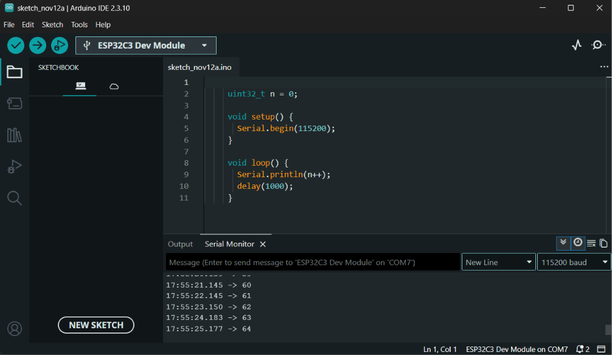
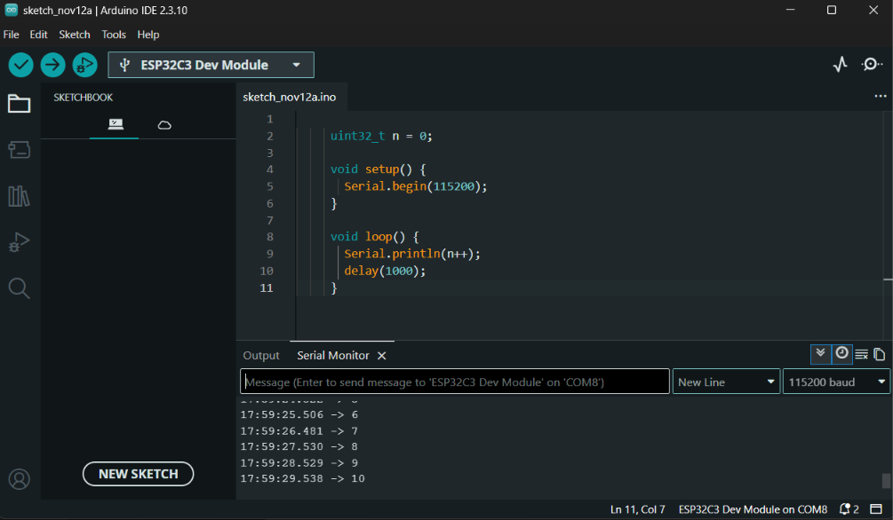

# Hafta 1: Çalışma Ortamı Kurulumu

**Kullandığım ortam:** Arduino IDE 2.3.10

## 1) Kurulum adımları

1. **Kart paketi:** Boards Manager URL'si eklendi, "esp32 by Espressif Systems" 3.3.12 sürümü yüklendi.
2. **Sürücü:** Ek sürücü kurulmadı, kartlar Windows'ta COM portu olarak göründü.
3. **Bağlantı:** USB-C veri kablosu.
4. **Kart seçimi:** ESP32C3 Dev Module
5. **USB seri ayarı:** USB CDC On Boot: Enabled
6. **Port:** Kart 1 → COM7, Kart 2 → COM8
7. **Seri port hızı:** 115200 baud
8. **Not:** İlk bağlantıda kart sürekli bağlanıp kopuyordu. BOOT + RST ile indirme moduna alındı, kod yüklendi, RST ile çalıştırıldı.

## 2) Sayaç test kodu

```cpp
uint32_t n = 0;

void setup() {
  Serial.begin(115200);
}

void loop() {
  Serial.println(n++);
  delay(1000);
}
```

Kod dosyası: [01_sayac.ino](../firmware/01_sayac/01_sayac.ino)

## Gerçek çıktı

Kart 1 (COM7):

```
17:55:21.145 -> 60
17:55:22.145 -> 61
17:55:23.150 -> 62
17:55:24.183 -> 63
17:55:25.177 -> 64
```

Kart 2 (COM8):

```
17:59:25.506 -> 6
17:59:26.481 -> 7
17:59:27.530 -> 8
17:59:28.529 -> 9
17:59:29.538 -> 10
```

## Ekran görüntüleri

Kart 1 (COM7):



Kart 2 (COM8):


