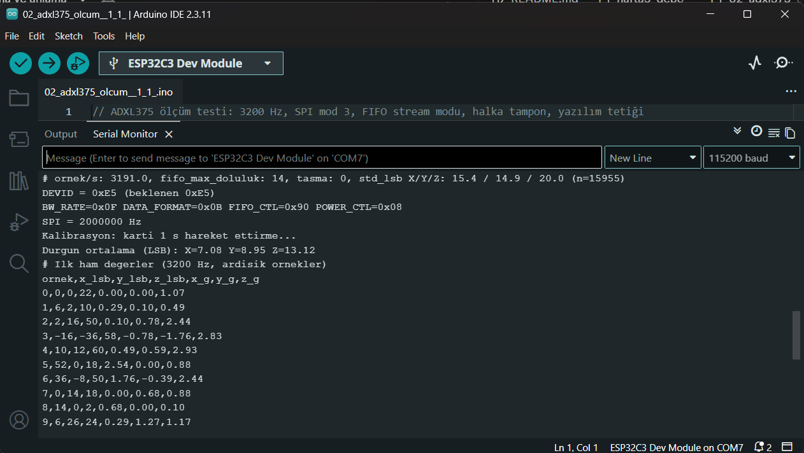
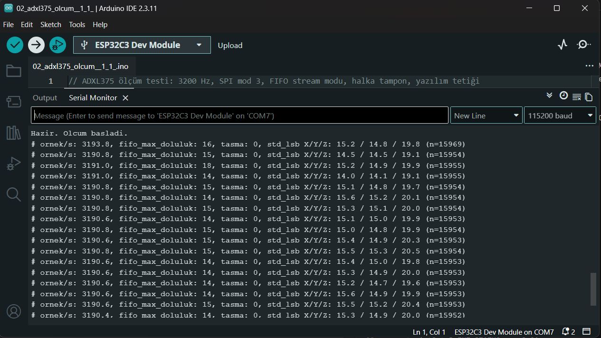
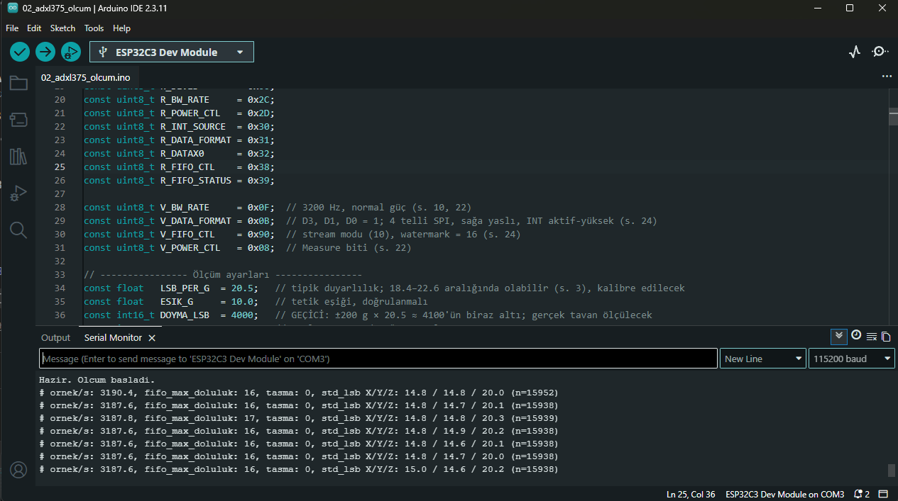
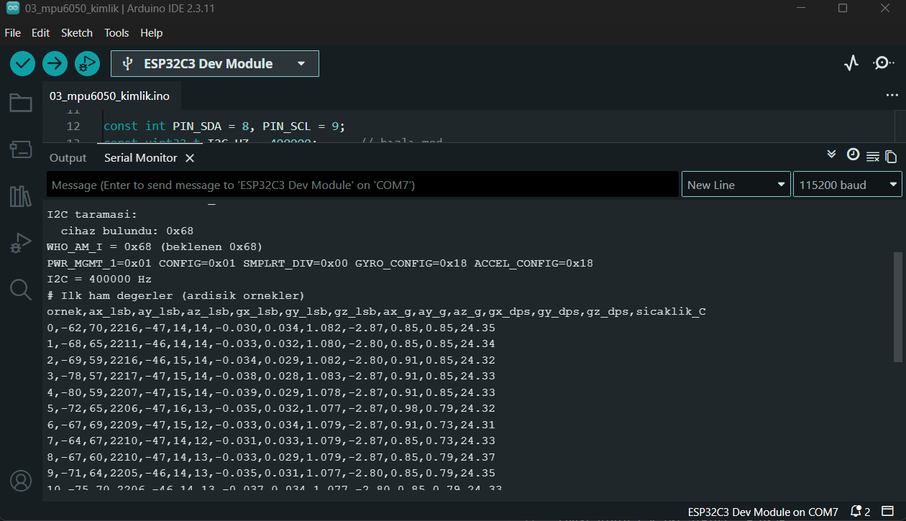
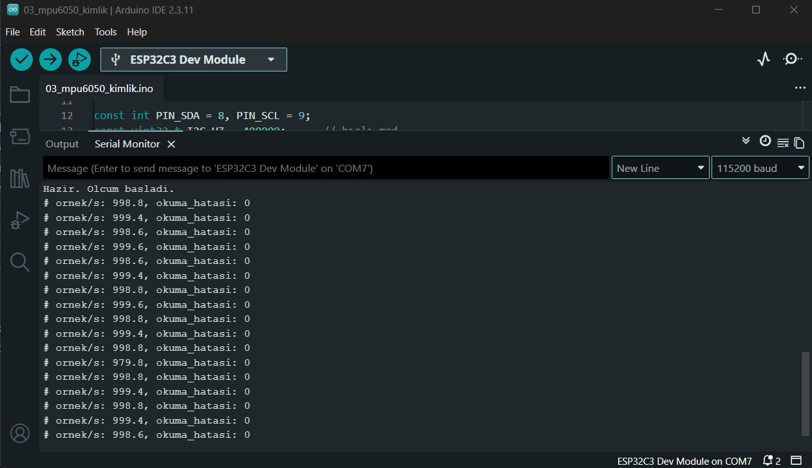
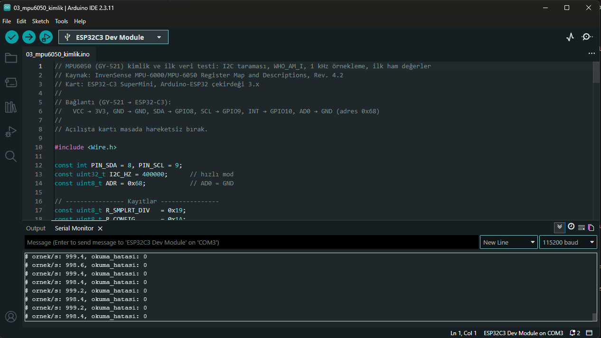

# Hafta 5: Sensörlerin Breadboard'da Doğrulanması

## Amaç
ADXL375 ve MPU6050'yi breadboard üzerinde ESP32-C3'e bağlamak, kimlik yazmacını okuyarak bağlantıyı doğrulamak, sabit örnekleme hızında veri alındığını göstermek ve ilk ham değerleri kaydetmek. Bu, 29 baytlık paket testinden (sonraki adım) önceki adımdır.

## Düzenek
| Parça | Arayüz | ESP32-C3 pinleri | Kod |
|---|---|---|---|
| Adafruit ADXL375 (5374) | SPI, mod 3, 2 MHz | SCK 4, MISO 5, MOSI 6, CS 7, INT 3 | `firmware/02_adxl375_olcum` |
| GY-521 MPU6050 | I2C, 400 kHz, adres 0x68 (AD0 → GND) | SDA 8, SCL 9, INT 10 | `firmware/03_mpu6050_kimlik` |

- Besleme: yalnız USB-C. Sensörler ESP32-C3'ün 3V3 pininden beslendi. Pil, TP4056 ve anahtar bağlı değildi.
- İki sensör aynı anda breadboard'daydı; her test için ilgili kod ayrı yüklendi.
- Ortam: Arduino IDE 2.3.11, esp32 by Espressif Systems 3.3.12, kart seçimi ESP32C3 Dev Module, USB CDC On Boot: Enabled, COM3.
- Kart masada hareketsizdi (Z ekseni yukarı).

## ADXL375 sonuçları

### Kimlik ve ayarlar
| Ölçüm | Sonuç |
|---|---|
| DEVID | 0xE5 (beklenen 0xE5), iki açılışta aynı |
| BW_RATE | 0x0F (3200 Hz) |
| DATA_FORMAT | 0x0B |
| FIFO_CTL | 0x90 (stream, watermark 16) |
| POWER_CTL | 0x08 (ölçüm) |

Okunan yazmaç değerleri yazılan değerlerle aynı.

### Örnekleme hızı
| Ölçüm | Sonuç |
|---|---|
| Hedef | 3200 Hz |
| Gerçekleşen | 3187–3190 örnek/s (5 s'lik pencereler, ESP32-C3'ün `millis()` saatiyle) |
| FIFO en fazla doluluk | 16–17 örnek (32'lik FIFO) |
| FIFO taşması | 0 |

### İlk ham değerler
İlk açılışın ilk 5 örneği (ham LSB; g değeri 20.5 LSB/g tipik duyarlılıkla):

```
ornek,x_lsb,y_lsb,z_lsb,x_g,y_g,z_g
0,28,52,0,1.37,2.54,0.00
1,8,4,8,0.39,0.20,0.39
2,-16,6,-28,-0.78,0.29,-1.37
3,-50,38,66,-2.44,1.85,3.22
4,-26,8,0,-1.27,0.39,0.00
```

Durgun ortalama (1 s, iki açılış): X = 8.60 / 8.05, Y = 8.28 / 7.89, Z = 13.10 / 12.66 LSB.

3200 Hz'de tüm ham değerler çift sayı çıktı. ADXL375 veri sayfası, 3200 Hz ve 1600 Hz çıkış hızında çıkış verisinin en düşük bitinin her zaman 0 olduğunu belirtiyor. 800 Hz'te tek sayılar da görüldü.

### Durağan gürültü
Kart hareketsizken her 5 s'lik penceredeki standart sapma:

| Çıkış hızı | Bant genişliği (ODR/2) | X std | Y std | Z std |
|---|---|---|---|---|
| 3200 Hz | 1600 Hz | 14.8–15.1 LSB (≈0.73 g) | 14.6–14.9 LSB (≈0.72 g) | 19.9–20.3 LSB (≈0.98 g) |
| 800 Hz | 400 Hz | 7.4–7.7 LSB (≈0.37 g) | 7.5–7.8 LSB (≈0.38 g) | 10.0–10.5 LSB (≈0.50 g) |

- Bant genişliği 4 kat daralınca standart sapma yarıya indi (oran 0.51–0.52). Gürültü geniş bantlı; düşük frekanslı bir dış etki (masa titreşimi gibi) değil.
- Buradan hesaplanan gürültü yoğunluğu X/Y ≈ 18 mg/√Hz, Z ≈ 25 mg/√Hz. Veri sayfasındaki tipik değer 5 mg/√Hz (VS = 2.5 V, ODR = 800 Hz koşullarında). Fark 3.6–5 kat. Kaynağı (sensörün kendisi mi, besleme mi) bu ölçümle ayrılamadı.
- g'ye çevirmede tipik duyarlılık (20.5 LSB/g) kullanıldı; gerçek duyarlılık 18.4–22.6 LSB/g aralığında olabilir.
- Sonraki ölçümler 3200 Hz'te yapılacak.

### Ekran görüntüleri
Kimlik ve ilk ham değerler (27 Kasım tekrarı, COM7):



Örnekleme hızı ve gürültü (27 Kasım tekrarı):



İlk oturumun hız/gürültü çıktısı:



## MPU6050 sonuçları

### Kimlik ve ayarlar
| Ölçüm | Sonuç |
|---|---|
| I2C taraması | Tek cihaz: 0x68 |
| WHO_AM_I | 0x68 (beklenen 0x68), iki açılışta aynı |
| PWR_MGMT_1 | 0x01 (uyanık, saat: X jiroskobu PLL) |
| CONFIG | 0x01 (DLPF_CFG = 1) |
| SMPLRT_DIV | 0x00 (1 kHz) |
| GYRO_CONFIG | 0x18 (±2000 °/s, 16.4 LSB/(°/s)) |
| ACCEL_CONFIG | 0x18 (±16 g, 2048 LSB/g) |

### Örnekleme hızı
| Ölçüm | Sonuç |
|---|---|
| Hedef | 1000 Hz |
| Gerçekleşen | Çoğu pencerede 998.2–999.6 örnek/s; bazı pencerelerde 988.6–989.4 örnek/s |
| Okuma hatası | 0 |

Kod veri hazır bayrağını sorgulayarak (polling) okuyor. 988 civarındaki pencerelerde örneklerin bir kısmı kaçmış olabilir. Asıl kodda MPU6050 FIFO'su veya INT kesmesi kullanılacak.

### İlk ham değerler
İlk 5 örnek (ilk açılış):

```
ornek,ax_lsb,ay_lsb,az_lsb,gx_lsb,gy_lsb,gz_lsb,ax_g,ay_g,az_g,gx_dps,gy_dps,gz_dps,sicaklik_C
0,-53,68,2234,-46,19,14,-0.026,0.033,1.091,-2.80,1.16,0.85,24.07
1,-55,71,2222,-45,18,12,-0.027,0.035,1.085,-2.74,1.10,0.73,24.04
2,-54,71,2214,-45,16,12,-0.026,0.035,1.081,-2.74,0.98,0.73,24.05
3,-51,67,2214,-45,17,12,-0.025,0.033,1.081,-2.74,1.04,0.73,24.09
4,-53,69,2207,-46,18,12,-0.026,0.034,1.078,-2.80,1.10,0.73,24.10
```

40 ham örneğin (iki açılış) özeti:

| Eksen | Ortalama | Standart sapma |
|---|---|---|
| ax | −0.028 g | 0.003 g |
| ay | +0.035 g | 0.002 g |
| az | +1.084 g | 0.005 g |
| gx | −2.82 °/s | 0.08 °/s |
| gy | +0.99 °/s | 0.09 °/s |
| gz | +0.80 °/s | 0.05 °/s |
| Sıcaklık | 24.0–24.8 °C | — |

- Ölçümler kalibre edilmemiş ham değerdir. az'nin 1 g'dan farkı ve jiroskobun sıfırdan farkı ofset/duyarlılık hatasıdır; açılışta ofset ölçülüp çıkarılacak.
- 20 örnek kısa bir pencere olduğu için standart sapmalar yaklaşık değerdir.

### Ekran görüntüleri
Kimlik, ayarlar ve ilk ham değerler (27 Kasım tekrarı, COM7):



Örnekleme hızı (27 Kasım tekrarı):



İlk oturumun çıktısı:



## Tekrar: 27 Kasım, ikinci oturum
Ekran görüntüsü için iki test, başka bir bilgisayarda (Arduino IDE 2.3.11, COM7) aynı kodlarla tekrarlandı.

| Ölçüm | ADXL375 | MPU6050 |
|---|---|---|
| Kimlik | DEVID = 0xE5 | WHO_AM_I = 0x68, taramada tek cihaz 0x68 |
| Yazmaçlar | BW_RATE 0x0F, DATA_FORMAT 0x0B, FIFO_CTL 0x90, POWER_CTL 0x08 | PWR_MGMT_1 0x01, CONFIG 0x01, SMPLRT_DIV 0x00, GYRO_CONFIG 0x18, ACCEL_CONFIG 0x18 |
| Gerçekleşen hız | 3190.4–3193.8 örnek/s | 998.6–999.6 örnek/s; bir pencerede 979.8 |
| FIFO / okuma hatası | FIFO en fazla 14–18, taşma 0 | okuma hatası 0 |
| Durağan ortalama / ilk değer | X = 7.08, Y = 8.95, Z = 13.12 LSB | ilk örnekte az = 1.082 g, gx = −2.87 °/s |
| Durağan gürültü (std, 3200 Hz) | X 14.0–15.6, Y 14.1–15.3, Z 19.1–20.5 LSB | — |
| Sıcaklık | — | 24.31–24.37 °C |

Kimlikler ve ayarlar ilk oturumla aynı. Örnekleme hızı ve gürültü ilk oturumla aynı düzeyde.

## İki sensörün karşılaştırması
| | ADXL375 (3200 Hz) | MPU6050 (1 kHz) |
|---|---|---|
| Ölçüm aralığı | ±200 g | ±16 g |
| Durağan ivme gürültüsü (std) | ≈0.7–1.0 g | ≈0.003–0.005 g |

Düşük ivmede MPU6050 çok daha az gürültülü; ±16 g'nin üstündeki darbelerde ise yalnız ADXL375 doymadan ölçebiliyor. İki sensörü birlikte kullanma gerekçesi bu ölçümle desteklendi.

## ADXL375'i SPI'da ölçüme alma adımları
Koddaki sıra (`firmware/02_adxl375_olcum`, veri sayfası sayfa numaraları kod açıklamalarında):

1. CS pini çıkış yapılır ve HIGH tutulur (sensör seçili değil).
2. SPI başlatılır: mod 3 (CPOL = 1, CPHA = 1), MSB önce, 2 MHz. Okuma için adres baytının en üst biti (R/W) 1, çok baytlı okumada ikinci bit (MB) de 1 yapılır.
3. DEVID (0x00) okunur; 0xE5 değilse kod durur.
4. POWER_CTL = 0x00: önce bekleme modu, ayarlar bu modda yazılır.
5. DATA_FORMAT = 0x0B: 4 telli SPI, sağa yaslı veri, INT aktif-yüksek.
6. BW_RATE = 0x0F: 3200 Hz çıkış hızı.
7. FIFO_CTL = 0x90: stream modu, watermark 16.
8. POWER_CTL = 0x08: Measure biti 1, ölçüm başlar.
9. Yazılan değerler geri okunup seri porta yazılır.

Adafruit kartında CS varsayılan olarak 3V'a çekilidir (I2C modu). ESP32-C3 her işlemde CS'yi LOW yaptığı için sensör SPI ile konuşur.

## Kimlik yanlış dönerse kontrol listesi
- 0x00 veya 0xFF dönüyorsa sensör hiç cevap vermiyor demektir:
  - VIN 3V3'e, GND GND'ye bağlı mı? Ray köprüleri takılı mı, raylar ortadan bölünük mü?
  - Header lehimleri parlak ve sağlam mı? Pin breadboard'da doğru sütunda mı?
  - CS kablosu GPIO7'de mi? CS boşta kalırsa sensör I2C modunda kalır.
- Başka bir değer dönüyorsa veri bozuluyor demektir:
  - SDO (MISO) GPIO5'e, SDA (MOSI) GPIO6'ya mı gidiyor? İkisi yer değiştirmiş olabilir.
  - SCL (SCK) GPIO4'te mi?
  - Kodda SPI modu 3 mü? SPI hızını geçici olarak 1 MHz'e düşürüp tekrar dene.
- MPU6050 için: taramada hiç cihaz yoksa VCC/GND ve SDA/SCL yerlerini, 0x69 çıkıyorsa AD0 kablosunu kontrol et.

## Not: sürekli CSV yazımı
3200 örnek/s'yi her örnek için bir CSV satırı olarak 115200 baud seri porttan aktarmak mümkün değil (satır başına yaklaşık 20 karakter → yaklaşık 64 000 karakter/s; 115200 baud yaklaşık 11 500 karakter/s taşır). Bu yüzden kod açılışta ilk 20 örneği CSV olarak yazıyor, sonra 5 s'lik özet satırları basıyor. Darbe penceresinin ham dökümü kodda `HAM_DOKUM = true` ile açılabilir.

## Uçtan uca paket testi (sensör → 29 bayt → ESP-NOW → alıcı)

### Düzenek
| Kart | Kod | Görev |
|---|---|---|
| Verici (breadboard) | `firmware/04_sensor_paket_verici` | ADXL375 3200 Hz + MPU6050 1 kHz okur, 0x01 paketini doldurur, yankıyla RTT ölçer |
| Alıcı | `firmware/05_sensor_paket_alici` | Paketi alır, hemen yankı gönderir, tüm alanları CSV yazar, kaybı sayar |

- İki tür 0x01 paketi: TEST (100 ms'de bir, son 100 ms'nin gerçek sensör özeti, `bayraklar` bit4 = 1) ve OLAY (bileşke ivme 10 g'yi aşınca, tetikten sonraki 320 örneğin özeti, bit4 = 0).
- Bu sürümde `hic15`, `seviye` ve `pil_mv` 0 gönderildi (hesap yeri, eşikler ve pil henüz yok). `delta_v` taslak tanımla (eşik üstü örneklerde |a|'nın integrali) dolduruldu.
- Kartlar arası ~20 cm, verici gücü 8.5 dBm, 1000 TEST paketi.
- Ortam: kalabalık bir kafe; 3–4 Wi-Fi ağı, çok sayıda elektronik cihaz ve kahve makineleri. Kontrol testi aynı oturumda, aynı yerde yapıldı. ESP-NOW kanalı seçilmedi (varsayılan).
- Ortam etkisini ayırmak için aynı yerde ve mesafede Hafta 4'ün sensörsüz kodu (06/07) yeniden çalıştırıldı.

### Sonuçlar
| Ölçüm | Hafta 4: sensörsüz, ilk ortam | Kontrol: sensörsüz, aynı ortam | Gerçek sensör verisiyle |
|---|---|---|---|
| Gönderilen / yankı alınan | 1000 / 1000 | 1000 / 996 | 1000 / 976 |
| Gidiş-dönüş kaybı | %0 | %0.4 | %2.4 |
| RTT min / ort / maks | 2.79 / 3.06 / 8.96 ms | 2.33 / 3.49 / 21.00 ms | 2.62 / 4.62 / 40.17 ms |
| RTT p50 / p95 / p99 (250 µs kutu) | ≤3.00 / ≤4.25 / ≤5.75 ms | ≤2.75 / ≤6.75 / ≤12.25 ms | ≤3.00 / ≤12.50 / ≤28.50 ms |
| RTT'si 10 ms'yi aşan paket | 0 | 14 | 61 |
| Tek yön tahmini (RTT/2) min / ort / maks | 1.40 / 1.53 / 4.48 ms | 1.17 / 1.74 / 10.50 ms | 1.31 / 2.31 / 20.09 ms |
| Test sırasında ADXL375 örnek/s, FIFO taşması | — | — | 3187.8–3191.2, 0 |
| Test sırasında MPU6050 örnek/s | — | — | 991.8–994.8 |
| Durağanken 100 ms'lik penceredeki tepe bileşke ivme | — | — | 2.06–4.36 g (ort. 3.37 g) |
| Durağanken açısal hız tepesi | — | — | 0.2–0.5 °/s |

Sensörlü testin p değerleri vericinin CSV satırlarından, kontrolle aynı 250 µs kutu yöntemiyle hesaplandı. (Verici kodunun ilk sürümündeki histogram 20 ms'de kesildiği için kodun kendi yazdığı "p99 ≤ 20000" değeri yanlıştı; histogram 100 ms'ye genişletildi.)

### Kayıpların yeri
- Sensörlü test, yankı gelmeyen 24 paket: sıra 122–126, 135–142, 152, 156–158, 167–169 (20 paket, yaklaşık 5 s içinde) ile 210, 282, 336, 711.
- Alıcının logu sıra 190–999 için var; bu aralıkta alıcı 210, 282, 336 ve 711'i hiç almamış. Kayıp vericiden alıcıya giden yolda.
- Kontrol testi: alıcıda eksik sıra 126, 273, 486, 576; vericide 996/1000 yankı ile tutarlı.
- Patlama dışında sensörlü testte kalan pakette 4 kayıp var, kontrolle aynı düzeyde.

### Darbe denemesi
ADXL375 kartına kalemle 9 kez vuruldu.

| Ölçüm | Sonuç |
|---|---|
| Vuruş / gönderilen olay paketi / yankı alınan | 9 / 10 / 10 |
| Olay zamanları (vericinin saati, s) | 226.65; 237.58, 237.79, 238.00, 238.21; 244.93, 245.17, 245.43, 246.08; 253.04 |
| Tepe bileşke ivme | 10.74, 12.89, 14.47, 14.06, 10.48, 23.77, 14.49, 11.75, 10.19, 16.33 g |
| Tetikten yankıya süre | 102.7–104.4 ms |
| Tetik sonrası özet penceresi | 320 örnek ≈ 100.4 ms (3188.8 örnek/s ile) |

Bu sürümde darbe → uyarı süresini kablosuz hat değil, özet penceresinin uzunluğu belirliyor.

9 vuruş 10 olay üretti: bir vuruş iki kez tetiklemiş (olası neden: kalemin sekmesi ya da kartın titreşimi; logdan hangi vuruş olduğu ayrılamıyor). Kod şu an bir olay penceresi biter bitmez yeni tetiğe izin veriyor. Aynı darbenin iki kez sayılmaması için pencereden sonra bir bekleme süresi (ölü zaman) gerekebilir; değeri: ___

### Değerlendirme
- Sensörsüz kontrol de Hafta 4'ten kötü çıktı; ölçüm ortamı sonucu etkiliyor. Kalabalık 2.4 GHz ortamı (birden fazla Wi-Fi ağı) olası bir neden; Hafta 4'ün ortamı kayıtlı değil, bu yüzden doğrudan karşılaştırma yapılamıyor.
- Aynı ortamda sensör okuması açıkken ortanca RTT değişmedi, uzun gecikmeler arttı (10 ms'yi aşan paket 61'e karşı 14).
- Kayıp farkının çoğu tek bir patlamadan geliyor; nedeni tek koşuyla ayrılamadı.
- Her koşu bir kez yapıldı; tekrarla doğrulanmadı.

Ham kayıtlar: [veri/hafta5](veri/hafta5).

## Sonraki adım
- Uzun gecikmeleri azaltmak için verici kodunda sensör okumasını kesmeye (INT) ve MPU6050 FIFO'suna geçirmek, sonra testi tekrarlamak.
- README'deki hedef değerleri kaynaklarıyla doldurmak (3/3).
- Menzil testi: ___
